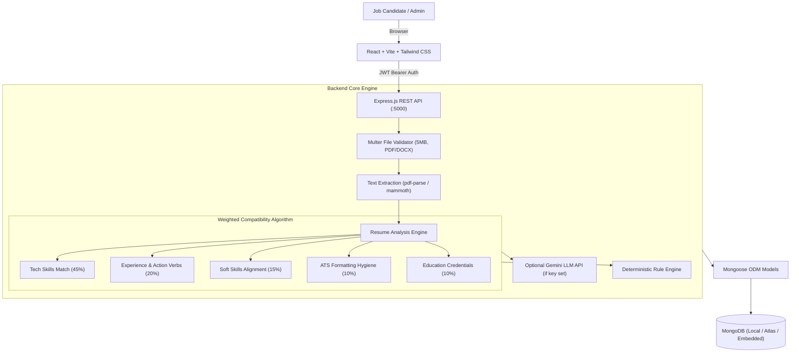

# ResumeAI — Next-Generation ATS Resume Intelligence & Diagnostic Platform

A modern, production-grade AI Resume Analyzer web application engineered for final-year **B.Tech Computer Science Engineering** capstone submission and real-world commercial SaaS deployment. Inspired by the minimal, high-craft aesthetics of **Linear**, **Stripe**, and **Notion**.

---

## 🌟 Executive Overview

In the modern tech hiring landscape, over **75% of resumes are filtered out by Applicant Tracking Systems (ATS)** before reaching a human engineering manager. Candidates frequently fail automated screening due to missing semantic keywords, non-standard headings, poor parseability, or passive phrasing.

**ResumeAI** solves this challenge by providing deterministic, multidimensional ATS diagnostics. Candidates upload their resume (PDF or DOCX) alongside a target job description to instantly uncover missing keywords, receive a weighted compatibility score, inspect structural ATS health, and obtain actionable improvement recommendations.

---

## 🛠️ Technology Stack (Strictly Implemented)

### Frontend
- **Framework:** React.js (v18.3)
- **Tooling & Bundler:** Vite (v5.4)
- **Styling:** Tailwind CSS (v3.4), PostCSS, Autoprefixer
- **Typography:** Inter Google Font
- **Icons:** Lucide React
- **Analytics & Data Visualizations:** Recharts (Radar, Area, Bar charts)
- **Routing:** React Router DOM (v6.23)

### Backend
- **Runtime:** Node.js (ES6+ / CommonJS)
- **Framework:** Express.js (v4.19)
- **Database & ODM:** MongoDB & Mongoose ODM (v8.3)
- **Embedded Database Fallback:** `mongodb-memory-server` (automatic zero-config fallback if local mongod is inactive)
- **Authentication:** JSON Web Tokens (JWT) with Bearer token header verification
- **Password Security:** `bcryptjs` with 10 salt rounds
- **File Upload Engine:** `multer` with strict MIME-type & extension validation (PDF, DOCX, DOC) and 5MB size limit
- **Document Text Extractors:** `pdf-parse` (PDF stream parsing) and `mammoth` (DOCX extraction)
- **Security:** Helmet HTTP headers, CORS whitelisting, Express Rate Limiter
- **AI Engine:** Dual-mode architecture:
  - High-accuracy deterministic rule-based ATS engine (500+ tech skills, 100+ soft skills, action verbs taxonomy)
  - Optional external Google Gemini LLM API integration via backend environment variables

---

## 📐 System Architecture & Workflow



---

## 📊 ATS Compatibility Scoring Formula

The overall match score (0–100) is calculated via a rigorous, weighted multi-factor formula:

$$\text{Match Score} = (0.45 \times S_{\text{tech}}) + (0.15 \times S_{\text{soft}}) + (0.20 \times S_{\text{exp}}) + (0.10 \times S_{\text{edu}}) + (0.10 \times S_{\text{format}})$$

| Category | Weight | Description |
| :--- | :--- | :--- |
| **Technical Skills ($S_{\text{tech}}$)** | **45%** | Boundary-aware token matching against languages, frameworks, cloud, databases, and DevOps tools. |
| **Experience Impact ($S_{\text{exp}}$)** | **20%** | Detection of quantifiable achievements and strong engineering action verbs (*Spearheaded, Engineered, Optimized*). |
| **Soft Skills ($S_{\text{soft}}$)** | **15%** | Cross-functional collaboration, leadership, problem solving, and agility markers. |
| **Education Match ($S_{\text{edu}}$)** | **10%** | Verification of academic prerequisites (B.Tech, B.S., M.S., Ph.D., Computer Science). |
| **ATS Hygiene ($S_{\text{format}}$)** | **10%** | Detection of contact email, reachable telephone, LinkedIn profile, section headers, and bullet density. |

> **Disclaimer:** The ATS compatibility score and recommendations provided by ResumeAI are algorithmic approximations designed to help candidates align their resumes with modern job descriptions. They do not guarantee interview callbacks or represent proprietary scorecards of individual enterprise ATS platforms (e.g., Workday, Taleo, Greenhouse).

---

## 🚀 Quick Start Guide

### 1. Prerequisites
- **Node.js:** v18.0.0 or higher (Tested on Node v20/v26)
- **MongoDB:** Local MongoDB daemon (`mongodb://127.0.0.1:27017`) **OR** MongoDB Atlas cluster URI **OR** no installation needed (the backend automatically starts an in-memory Mongo server if local mongod is not detected!).

### 2. Installation
Open your terminal in the project directory:

```bash
# Clone or navigate to the workspace
cd "NOAH SESD"

# Install Backend dependencies
cd backend
npm install

# Install Frontend dependencies
cd ../frontend
npm install
```

### 3. Environment Variables
Both `backend/.env` and `frontend/.env` are pre-configured:

#### `backend/.env`:
```env
PORT=5000
NODE_ENV=development
MONGO_URI=mongodb://127.0.0.1:27017/resume_ai
JWT_SECRET=resume_ai_super_secret_jwt_key_2026_btech_project
JWT_EXPIRES_IN=30d

# Optional External LLM API Key (Google Gemini)
# Leave blank to run high-accuracy built-in rule-based ATS engine
GEMINI_API_KEY=
```

#### `frontend/.env`:
```env
VITE_API_URL=/api
```

### 4. Running the Application

In **Terminal 1** (Start Backend):
```bash
cd backend
npm start
```
*The backend server will start on `http://localhost:5000` and automatically seed initial demo accounts.*

In **Terminal 2** (Start Frontend):
```bash
cd frontend
npm run dev
```
*The Vite development server will start on `http://localhost:5173`.*

Open your browser and navigate to: **`http://localhost:5173`**

---

## 🔑 Pre-Seeded Demo Accounts

For immediate testing, presentations, and examiner evaluations:

| Role | Email | Password | Privileges |
| :--- | :--- | :--- | :--- |
| **Candidate Demo** | `demo@resumeai.com` | `demo123` | Full access to candidate dashboard, resume uploads, analysis diagnostics, and history. |
| **Admin Demo** | `admin@resumeai.com` | `admin123` | Full candidate access + Admin Dashboard, user management table, role toggling, and platform analytics. |

*(Both accounts can also be filled with 1 click using the "Quick Demo Accounts" pill box on the Login Page!)*

---

## 🖥️ Website Pages & Capabilities

### 1. Landing Page (`/`)
- Modern SaaS hero section with headline: *"Build a Resume That Gets You Hired."*
- Dual CTA: **"Analyze Your Resume Now"** and **"Try Live Demo (1-Click)"**.
- Interactive diagnostic mockup preview card.
- Metrics banner (100k+ Scans, 88% boost, 500+ skills).
- Core features grid (Deep Skill Extraction, Weighted Scoring, Missing Keyword Discovery, Action Verbs, ATS Hygiene).
- 4-step workflow showcase.
- Sample/Demo candidate testimonials with verified score tags.
- Transparent pricing tiers (Student, Pro, Campus).
- Expandable interactive FAQ accordion.
- Polished footer with system status indicator and legal disclaimer.

### 2. Authentication (`/login`, `/register`)
- JWT-based authentication with bcrypt.js password hashing.
- 1-Click demo credential quick-fill.
- Forgot password modal with recovery token simulation.
- Route guards (`ProtectedRoute` and `AdminRoute`).

### 3. User Dashboard (`/dashboard`)
- Dynamic personalized greeting.
- 4 KPI cards: Total Scans, Average ATS Score, Best Match Score, Stored Resumes.
- **Recharts Area Chart:** Visual progression of match scores across recent job applications.
- Recommended actions & quick tips widget.
- Recent analyses table with direct report links and delete actions.

### 4. Resume Upload & Analysis (`/analyze`)
- Drag-and-drop zone with MIME-type and size validation (PDF & DOCX).
- Switchable modes: Upload new file, choose previously uploaded resume, or direct paste.
- Target job specification inputs (Job Title, Company, Job Description).
- **Quick-fill sample job descriptions:**
  - *Senior Full-Stack Engineer (Stripe/Fintech)*
  - *Frontend React Developer (SaaS)*
  - *AI & Data Platform Engineer (Cloud)*
- Quick-fill sample candidate resume button.
- Animated multi-step progress bar during processing.

### 5. Analysis Results (`/analysis/:id`)
- Prominent match score gauge (0–100) with grade badge (A+, A, B, C, Needs Improvement).
- Estimated compatibility disclaimer alert.
- Executive Recruiter Summary.
- **Recharts Radar Chart:** Multidimensional balance across Technical Skills, Soft Skills, Experience Depth, Education, and Formatting.
- Skills matrix: Matched skills (green) vs. Missing critical skills (red/amber) with `+ Add` recommendations.
- Work experience analysis: Detected years, seniority estimate, action verbs count and list.
- Education credentials verification.
- ATS formatting hygiene checklist (Email, Phone, Links, Section headers, Bullet points).
- Prioritized improvement roadmap (High, Medium, Low priority).
- Keyword density & placement strategy table.
- **Print / Export PDF** capability.

### 6. Resume History (`/history`)
- Real-time search by job title, company, or file name.
- Score filter dropdown (All, Strong Match >=80%, Fair Match 60-79%, Low <60%).
- Sort by newest, oldest, highest score, lowest score.
- Direct report inspection and cascading deletion.

### 7. Profile & Settings (`/profile`)
- Account information (display name, email, headline title, bio).
- Change password with old password verification and bcrypt hashing.
- Role badges and logout action.

### 8. Admin Control Panel (`/admin`)
- Accessible only by accounts with `role: 'admin'`.
- Platform KPIs: Total users, total resumes, total analyses, platform average score.
- **Recharts Bar Chart:** Score distribution tiers aggregated via MongoDB `$bucket`.
- User management table: Avatar, username, email, role, resume count, analysis count, date joined.
- User management actions: Toggle user/admin role, delete user account (with cascade cleanup of resumes and analyses).

---

## 📡 REST API Reference

### Authentication (`/api/auth`)
| Method | Endpoint | Access | Description |
| :--- | :--- | :--- | :--- |
| `POST` | `/api/auth/register` | Public | Register new candidate account. |
| `POST` | `/api/auth/login` | Public | Authenticate user & return JWT token. |
| `GET` | `/api/auth/me` | Private | Retrieve authenticated user profile. |
| `PUT` | `/api/auth/profile` | Private | Update username, email, title, bio. |
| `PUT` | `/api/auth/change-password` | Private | Verify current password and update. |

### Resume Operations (`/api/resumes`)
| Method | Endpoint | Access | Description |
| :--- | :--- | :--- | :--- |
| `POST` | `/api/resumes/upload` | Private | Upload PDF/DOCX file and extract text. |
| `GET` | `/api/resumes` | Private | List all uploaded resumes for user. |
| `GET` | `/api/resumes/:id` | Private | Get single resume details & extracted text. |
| `DELETE` | `/api/resumes/:id` | Private | Delete resume and cascade delete analyses. |

### Analysis Operations (`/api/analysis`)
| Method | Endpoint | Access | Description |
| :--- | :--- | :--- | :--- |
| `POST` | `/api/analysis/analyze` | Private | Analyze resume vs. JD and save result. |
| `GET` | `/api/analysis/history` | Private | Fetch user history with search & filter. |
| `GET` | `/api/analysis/:id` | Private | Fetch detailed analysis diagnostics by ID. |
| `DELETE` | `/api/analysis/:id` | Private | Delete analysis record. |

### Administration (`/api/admin`)
| Method | Endpoint | Access | Description |
| :--- | :--- | :--- | :--- |
| `GET` | `/api/admin/dashboard` | Private/Admin | Platform KPIs, score distribution aggregations. |
| `GET` | `/api/admin/users` | Private/Admin | List all registered users with metrics. |
| `PUT` | `/api/admin/users/:id/role`| Private/Admin | Promote/demote user to/from admin. |
| `DELETE` | `/api/admin/users/:id` | Private/Admin | Delete user and cascade purge data. |

---

## 🔒 Security & Quality Standards

- **Password Encryption:** 10 salt rounds with `bcryptjs`.
- **JWT Protection:** Private endpoints require `Authorization: Bearer <token>` header.
- **Role-Based Access Control:** Strict middleware guards `/api/admin/*` and the `/admin` frontend route.
- **Data Isolation:** Queries strictly scoped by `userId` to prevent horizontal privilege escalation.
- **File Validation:** Multer restricts uploads to `.pdf`, `.docx`, `.doc` and enforces a 5MB upper ceiling.
- **Rate Limiting:** Express rate limiter guards API routes against denial-of-service and brute force attempts.
- **Security Headers:** Configured via `helmet`.

---

## 👨‍💻 Project Information & Academic Viva Readiness

- **Project Title:** ResumeAI — AI Resume Analyzer Full-Stack Web Application
- **Domain:** Artificial Intelligence, Software Engineering, Full-Stack Web Development, Human-Computer Interaction
- **Degree:** Bachelor of Technology (B.Tech) in Computer Science & Engineering
- **Key Modules:** Text extraction pipelines, semantic regex tokenization, multidimensional weighted scoring, role-based MongoDB architecture, responsive React UI.

*Built with precision, modern design standards, and complete full-stack integration.*
